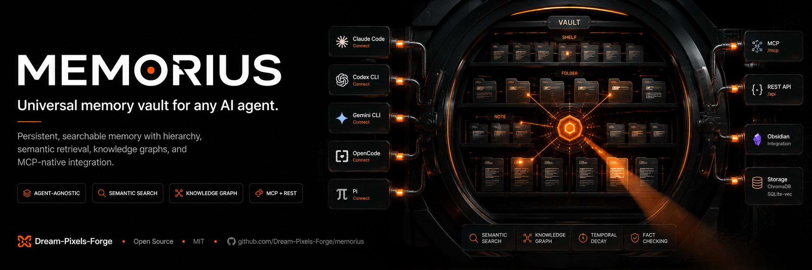

# Memorius


<p align="center">
  <strong>Universal memory vault for any AI agent.</strong>
</p>

<p align="center">
  <a href="https://pypi.org/project/memorius/"></a>
  <a href="https://github.com/Dream-Pixels-Forge/memorius/actions/workflows/test.yml"></a>
  <a href="https://github.com/Dream-Pixels-Forge/memorius/actions/workflows/release.yml"></a>
  <a href="https://opensource.org/licenses/MIT"></a>
  <a href="https://python.org"></a>
  <a href="https://github.com/Dream-Pixels-Forge/memorius/blob/main/CHANGELOG.md"></a>
</p>

> **Works with Claude Code, Codex CLI, Gemini CLI, OpenClaude, OpenCode, Pi, OpenClaw, and any MCP-compatible agent.**
>
> **📚 Documentation:** https://dream-pixels-forge.github.io/memorius/ — install, CLI reference, MCP server, hooks, REST API, architecture, and the memory engine, all on the site.
>
> If you find this project useful, leaving a star ⭐ on the repository is the best way to support my work!

Memorius is a self-contained, agent-agnostic memory system with hierarchical knowledge
organization, pluggable embeddings, and neuroscience-inspired consolidation. One vault,
many frontends — CLI, MCP, REST, and auto-detecting agent hooks. **No cloud, no API keys,
no lock-in.**

## Install

```bash
pip install memorius
```

All features — vector search, cross-encoder reranker, REST API server, SQLite-vec backend,
OpenAI embeddings, knowledge graph, and the agent skill — are included out of the box. No
extra install flags needed.

Verify:

```bash
memorius --version
memorius init          # creates ~/.memorius/config.yaml + storage dir
```

## CLI Reference

### memorius stats
Show vault + memory + graph statistics
   --json    Output as JSON

### memorius status
Show vault status
   --json    Output as JSON


### memorius bookcase
Launch the 3D walkable vault bookcase (browser opens automatically, loopback only).
   --port <n>        REST API port (default: 8912)
   --static-port <n> Static asset port for the bookcase page (default: 8400)
   --no-browser      Don't open the browser; just serve the page


## Vault Bookcase (3D walkable)

Run the bookcase:

```bash
memorius bookcase
```

It starts the REST API on `http://127.0.0.1:8912`, serves the bookcase page on
`http://127.0.0.1:8400/bookcase.html`, and opens your browser. Everything is
loopback-only — nothing leaves your machine.

Use `memorius bookcase --no-browser` to serve without opening a tab, then open
the printed URL yourself. Use `--port` / `--static-port` if the defaults are
taken.

Once the page is open:

- **Walk:** WASD or arrow keys at eye height. You can't pass through shelves.
- **Look:** click-drag to look around (pointer-lock if available).
- **Vault:** pick a vault from the dropdown (options come from `GET /vaults`).
- **Layout:** switch between "by shelf" and "by recency" to re-arrange cases.
- **Search:** type in the vault search bar and hit Enter/Go — the camera flies
  to the matching book and marks it.
- **Book click:** click a book to open its detail panel (content + librarian
  speech when the Librarian toggle is on).
- **Mic:** hold the mic button to speak your search (Chromium only).
- **Reset view:** click ⟲ view to return to the starting camera position.

The librarian reads each book aloud when toggled on; all utterances are also
logged in the guidance panel on the page.


<details>
<summary><b>For development</b></summary>

```bash
pip install "memorius[dev]"   # adds pytest + pytest-asyncio
```

</details>

## Quick start

```bash
# Initialize a vault
memorius init

# Store a memory
memorius store "The sky is blue because Rayleigh scattering scatters shorter wavelengths more" \
  --vault main --shelf science --folder physics

# Semantic search
memorius search "why is the sky blue"

# Mine memories from a conversation
memorius mine transcript.txt --vault conversations

# Check status
memorius status
```

That's the whole loop: **store → embed → search**. Read the
[Getting Started guide](https://dream-pixels-forge.github.io/memorius/getting-started.html)
for the vault hierarchy, the agent skill, and a recommended first-week flow.

## Documentation

The full docs live on the site — each concern on its own page:

| Page | What's on it |
|---|---|
| [Getting Started](https://dream-pixels-forge.github.io/memorius/getting-started.html) | Install, init, first memory, the Vault→Shelf→Folder→Note hierarchy, agent skill |
| [CLI Reference](https://dream-pixels-forge.github.io/memorius/cli-reference.html) | Every subcommand and flag (incl. `repair` and `--json`) |
| [MCP Server](https://dream-pixels-forge.github.io/memorius/mcp-server.html) | All 29 tools + per-agent client config snippets |
| [Agent Hooks](https://dream-pixels-forge.github.io/memorius/hooks.html) | Auto-detecting lifecycle hooks, 10 actions, normalizers, security |
| [REST API](https://dream-pixels-forge.github.io/memorius/rest-api.html) | Full endpoint table, auth, rate limits, daemon mode, TLS |
| [Architecture](https://dream-pixels-forge.github.io/memorius/architecture.html) | Search pipeline, embeddings, vector backends, graph, configuration |
| [Agent Compatibility](https://dream-pixels-forge.github.io/memorius/agents.html) | Which agents, detection priority, how to plug in your own |
| [Memory Engine](https://dream-pixels-forge.github.io/memorius/consolidation.html) | Decay, consolidation, pruning, fact-checking, reranking, doctor, repair |

<details>
<summary><b>Command cheat sheet</b> (details on the <a href="https://dream-pixels-forge.github.io/memorius/cli-reference.html">CLI reference</a>)</summary>

```bash
memorius store "text" [--vault/--shelf/--folder/--note/--ttl]
memorius search "query" [--n/--expand-graph/--rerank/--web/--tag]
memorius mine file.txt [--vault/--text]
memorius extract file.txt [--backend openai|ollama|regex]
memorius diary "session" [--title/--summary]
memorius ls [vault]
memorius consolidate [--threshold/--dry-run]
memorius factcheck "stmt" [--web]
memorius profile "session"
memorius prune [--threshold/--dry-run/--delete]
memorius graph [view|export-html|stats|json]
memorius learn "text" --category bug_fix
memorius recall "query"
memorius obsidian [list|import|export]
memorius export ./backup [--format json|markdown]
memorius import ./backup.json [--replace]
memorius doctor            # 6 health checks
memorius repair [--reindex/--dry-run]   # fix vector/meta drift (v0.8.6)
memorius stats [--json]      # vault + memory + graph + doctor summary
memorius status [--json]    # vault + embeddings + recent diaries
memorius serve               # MCP server (stdio)
memorius serve-rest [--daemon/--stop]   # FastAPI server
```

</details>

## License

[MIT](LICENSE) · Full release history in [CHANGELOG.md](CHANGELOG.md).
