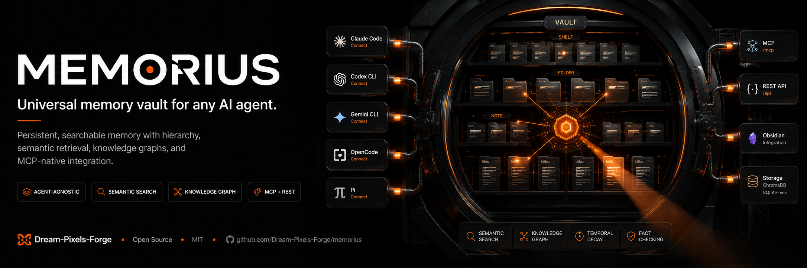

# Memorius



<p align="center">
  <strong>Universal memory vault for any AI agent.</strong>
</p>

<p align="center">
  <a href="https://pypi.org/project/memorius/"></a>
  <a href="https://github.com/Dream-Pixels-Forge/memorius/actions/workflows/test.yml"></a>
  <a href="https://github.com/Dream-Pixels-Forge/memorius/actions/workflows/release.yml"></a>
  <a href="https://opensource.org/licenses/MIT"></a>
  <a href="https://github.com/Dream-Pixels-Forge/memorius/blob/main/CHANGELOG.md"></a>
  <a href="https://python.org"></a>
</p>

---

Persistent, searchable memory with hierarchy, semantic retrieval, knowledge graphs, and MCP-native integration — for **Claude Code, Codex CLI, Gemini CLI, OpenClaude, OpenCode, Pi, OpenClaw**, and any MCP-compatible agent.

> **📚 Documentation:** https://dream-pixels-forge.github.io/memorius/ — CLI reference, MCP server, hooks, REST API, architecture, and the memory engine.
>
> Found this useful? Leave a **star ⭐** — it's the best way to support the project.

---

## What Memorius gives you

| | |
|---|---|
| 🧠 **Hierarchical vault** | Vault → Shelf → Folder → Note. Organize memory like a library, not a flat bucket. |
| 🔍 **Semantic search** | Vector similarity with cross-encoder reranking and temporal-decay ranking. |
| 🕸️ **Knowledge graph** | Entity co-occurrence graph with path-finding and relation extraction. |
| 🔌 **MCP + REST servers** | `memorius serve` (stdio MCP) and `memorius serve-rest` (FastAPI, TLS, auth). |
| 🪝 **Agent hooks** | Auto-detecting lifecycle hooks for 7+ AI coding agents — normalizers + security. |
| 📖 **3D bookcase** | Walkable first-person vault browser (`memorius bookcase`) with librarian hippo. |
| 🔄 **Consolidation** | Neuroscience-inspired decay, pruning, and fact-checking to keep memory fresh. |
| 🔒 **No lock-in** | Local-first, ChromaDB + SQLite-vec backends, no cloud, no required API keys. |

---

## Install

```bash
pip install memorius
```

All features — vector search, cross-encoder reranker, REST API server, SQLite-vec backend, OpenAI embeddings, knowledge graph, agent hooks — are included out of the box. No extra install flags needed.

Verify:

```bash
memorius --version
memorius init          # creates ~/.memorius/config.yaml + storage dir
```

---

## Quick start

```bash
# 1. Initialize a vault
memorius init

# 2. Store a memory
memorius store "The sky is blue because Rayleigh scattering scatters shorter wavelengths more" \
  --vault main --shelf science --folder physics

# 3. Semantic search
memorius search "why is the sky blue"

# 4. Mine memories from a conversation
memorius mine transcript.txt --vault conversations

# 5. Check vault status
memorius status
```

That's the whole loop: **store → embed → search**. Read the [Getting Started guide](https://dream-pixels-forge.github.io/memorius/getting-started.html) for the vault hierarchy, agent skill, and a recommended first-week flow.

---

## CLI at a glance

<details>
<summary><b>Expand command cheat sheet</b></summary>

```bash
memorius store "text"       [--vault/--shelf/--folder/--note/--ttl]
memorius search "query"     [--n/--expand-graph/--rerank/--web/--tag]
memorius mine file.txt      [--vault/--text]
memorius extract file.txt   [--backend openai|ollama|regex]
memorius diary "session"    [--title/--summary]
memorius ls [vault]
memorius consolidate        [--threshold/--dry-run]
memorius factcheck "stmt"   [--web]
memorius profile "session"
memorius prune              [--threshold/--dry-run/--delete]
memorius graph              [view|export-html|stats|json]
memorius learn "text"       --category bug_fix
memorius recall "query"
memorius obsidian           [list|import|export]
memorius export ./backup    [--format json|markdown]
memorius import ./backup.json [--replace]
memorius doctor             # 6 health checks
memorius repair             [--reindex/--dry-run]
memorius stats [--json]     # vault + memory + graph + doctor summary
memorius status [--json]    # vault + embeddings + recent diaries
memorius serve              # MCP server (stdio)
memorius serve-rest         [--daemon/--stop]  # FastAPI server
memorius bookcase           # 3D walkable vault browser
```

</details>

---

## Vault Bookcase (3D walkable)

Run the bookcase:

```bash
memorius bookcase
```

It starts the REST API on `http://127.0.0.1:8912`, serves the bookcase page on `http://127.0.0.1:8400/bookcase.html`, and opens your browser. Everything is loopback-only — nothing leaves your machine.

**Walk:** WASD or arrow keys · **Shift** to hurry · **Click** to grab mouse-look · **/** to ask the librarian · **M** for floor plan · **?** for all controls.

---

## Documentation

The full docs live on the site — each concern on its own page:

| Page | What's on it |
|---|---|
| [Getting Started](https://dream-pixels-forge.github.io/memorius/getting-started.html) | Install, init, first memory, Vault→Shelf→Folder→Note hierarchy, agent skill |
| [CLI Reference](https://dream-pixels-forge.github.io/memorius/cli-reference.html) | Every subcommand and flag (incl. `repair` and `--json`) |
| [MCP Server](https://dream-pixels-forge.github.io/memorius/mcp-server.html) | All 29 tools + per-agent client config snippets |
| [Agent Hooks](https://dream-pixels-forge.github.io/memorius/hooks.html) | Auto-detecting lifecycle hooks, 10 actions, normalizers, security |
| [REST API](https://dream-pixels-forge.github.io/memorius/rest-api.html) | Full endpoint table, auth, rate limits, daemon mode, TLS |
| [Architecture](https://dream-pixels-forge.github.io/memorius/architecture.html) | Search pipeline, embeddings, vector backends, graph, configuration |
| [Agent Compatibility](https://dream-pixels-forge.github.io/memorius/agents.html) | Which agents, detection priority, how to plug in your own |
| [Memory Engine](https://dream-pixels-forge.github.io/memorius/consolidation.html) | Decay, consolidation, pruning, fact-checking, reranking, doctor, repair |

---

## License & support

[MIT](LICENSE) · Full release history in [CHANGELOG.md](CHANGELOG.md).

Built by [Dream-Pixels-Forge](https://github.com/Dream-Pixels-Forge). Open source.
